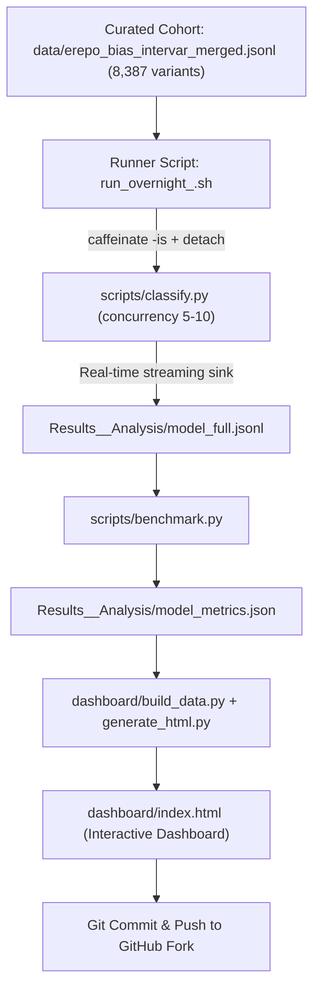

# AIVA Variant Benchmark: Complete Manual Operations & Developer Guide

This guide provides the exact step-by-step workflow to benchmark any new model manually, write detached runner scripts with auto-resumption, generate metrics, update the interactive dashboard, and commit/push results to the GitHub repository.

---

## 1. Overview of the Pipeline Architecture



---

## 2. Step 1: Write the `.sh` Runner Script for a New Model

Create a script named `run_overnight_<model_name>.sh` in the repository root.

### Standard Template: `run_overnight_<model_name>.sh`

```bash
#!/bin/bash
# Full-cohort classification for <MODEL_NAME>, concurrency 5-10.
# Auto-resumes: skips variants already classified in previous passes.
cd "$(dirname "$0")" || exit 1

# 1. Load environment variables & API tokens
set -a; source .env; set +a
unset SSL_CERT_FILE
export MPLCONFIGDIR=/tmp/mpl_cache

# 2. Python environment
PYTHON_BIN="/tmp/aiva_env/bin/python3"
if [[ ! -x "$PYTHON_BIN" ]]; then
  PYTHON_BIN="python3"
fi

# 3. Model identifier & output destination
MODEL="<PROVIDER/MODEL_ID>"  # e.g., "anthropic/claude-sonnet-5-5", "google/gemini-2.5-flash", "openai/gpt-4o"
OUT="Results_<Model>_Analysis/<model>_full.jsonl"
mkdir -p "$(dirname "$OUT")"

# 4. Multi-pass loop (automatically retries any dropped/rate-limited variants)
passlog="$(mktemp -t passlog)"
trap 'rm -f "$passlog"' EXIT

for pass in {1..10}; do
  echo "=== $(date '+%F %T')  pass $pass  $MODEL ==="
  "$PYTHON_BIN" -u scripts/classify.py \
    --input data/erepo_bias_intervar_merged.jsonl \
    --output "$OUT" \
    --model "$MODEL" \
    --concurrency 5 | tee "$passlog"
  
  rc=${PIPESTATUS[0]}
  echo "=== $(date '+%F %T')  pass $pass finished (exit $rc) ==="
  
  # Exit early if all variants are completed
  if grep -q "Nothing left to classify" "$passlog"; then
    break
  fi
  sleep 30
done

echo "=== $(date '+%F %T')  ALL DONE ==="
```

### Make it executable:
```bash
chmod +x run_overnight_<model_name>.sh
```

---

## 3. Step 2: Launch the Job in the Background (Survives Disconnects)

To ensure the job does not die when your terminal window or laptop lid closes:

```bash
/tmp/aiva_env/bin/python3 -c "
import os, subprocess
from datetime import datetime

model_tag = '<model_name>'
ts = datetime.now().strftime('%Y%m%d_%H%M%S')
log_file = f'run_overnight_{model_tag}_{ts}.log'
pid_file = f'run_overnight_{model_tag}.pid'

cmd = ['caffeinate', '-is', f'./run_overnight_{model_tag}.sh']
with open(log_file, 'w') as f, open('/dev/null', 'r') as devnull:
    p = subprocess.Popen(cmd, stdin=devnull, stdout=f, stderr=subprocess.STDOUT, preexec_fn=os.setpgrp)

with open(pid_file, 'w') as f:
    f.write(str(p.pid))

print(f'Started {model_tag} background job PID {p.pid}')
print(f'Logging to {log_file}')
"
```

---

## 4. Step 3: Monitor Active Runs

```bash
# 1. Check live classification progress:
tail -f run_overnight_<model_name>_*.log

# 2. Count classified variants (out of 8,387):
wc -l Results_<Model>_Analysis/<model>_full.jsonl

# 3. Verify process PID status:
ps -fp $(cat run_overnight_<model_name>.pid)

# 4. To stop safely (resumes automatically without data loss):
kill $(cat run_overnight_<model_name>.pid)
```

---

## 5. Step 4: Calculate Metrics Once the Run Finishes

Once `wc -l Results_<Model>_Analysis/<model>_full.jsonl` reaches **8,387**:

```bash
/tmp/aiva_env/bin/python3 scripts/benchmark.py \
  --input Results_<Model>_Analysis/<model>_full.jsonl \
  --output Results_<Model>_Analysis/<model>_metrics.json
```

This outputs:
- **Exact Match (5-Class) Accuracy & Macro F1**
- **Directional (3-Class) Accuracy & Macro F1**
- **Per-Class Precision, Recall, and F1** (Pathogenic, LP, VUS, LB, Benign)
- **Critical Errors** (False Pathogenic overcalls & False Benign undercalls)

---

## 6. Step 5: Update the Dashboard

### 1. Register the model in `dashboard/build_data.py`:
Add a block to `discover_models()`:

```python
    # New Model Registration
    model_file = repo_root / "Results_<Model>_Analysis" / "<model>_full.jsonl"
    if model_file.exists():
        discovered["<model_key>"] = {
            "name": "<Display Name>",
            "short_name": "<Short Name>",
            "family": "Anthropic Claude",  # or "Google Gemini", "OpenAI", etc.
            "is_anthropic": True,
            "type": "Autonomous Agent (AIVA)",  # or "Direct Prompt (Claude Code)"
            "path": str(model_file),
            "format": "jsonl",  # or "json_array" for Claude Code
            "color": "#9333EA",
            "description": "Evaluation of <Model> across 8,387 ClinGen variants.",
        }
```

### 2. Re-generate the dashboard data and HTML:
```bash
/tmp/aiva_env/bin/python3 dashboard/build_data.py
/tmp/aiva_env/bin/python3 dashboard/generate_html.py
```
*(or run `python scripts/update_dashboard.py`)*

### 3. Preview locally:
```bash
/tmp/aiva_env/bin/python3 dashboard/server.py 8080
# Visit http://localhost:8080
```

---

## 7. Step 6: Commit and Push to the Fork

### 1. Update `.gitignore`:
Ensure your new results files are unignored in `.gitignore`:
```gitignore
!Results_<Model>_Analysis/<model>_full.jsonl
!Results_<Model>_Analysis/<model>_metrics.json
```

### 2. Prevent macOS Sandbox mmap error on large JSONL files (>500KB):
```bash
# Strip Apple quarantine attributes
xattr -d com.apple.provenance Results_<Model>_Analysis/<model>_full.jsonl 2>/dev/null || true

# Mark assume-unchanged so git doesn't stat/mmap during status
git update-index --assume-unchanged Results_<Model>_Analysis/<model>_full.jsonl
```

### 3. Stage, Commit, and Push:
```bash
git add .gitignore dashboard/build_data.py dashboard/index.html Results_<Model>_Analysis/
git commit -m "feat(benchmark): add <Model> results (8,387 variants) and update dashboard"
git push origin benchmark-dashboard
```
